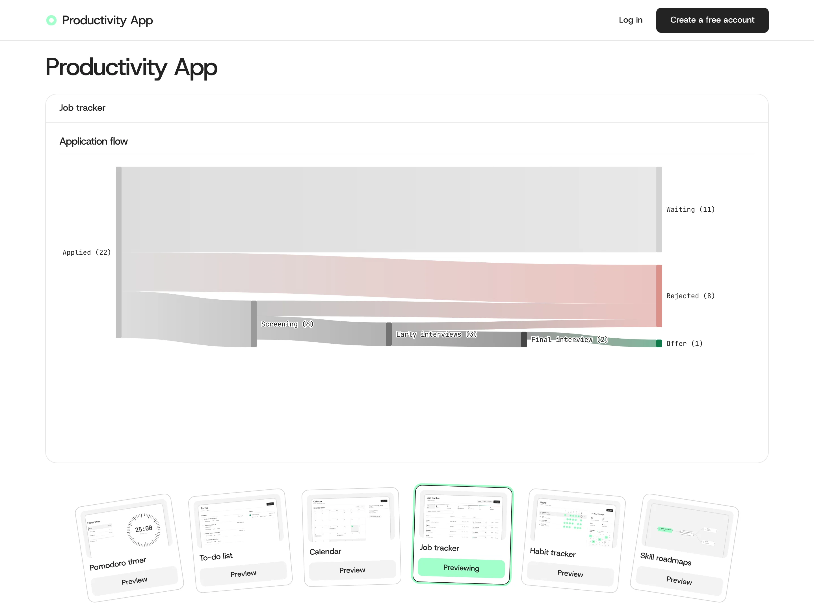
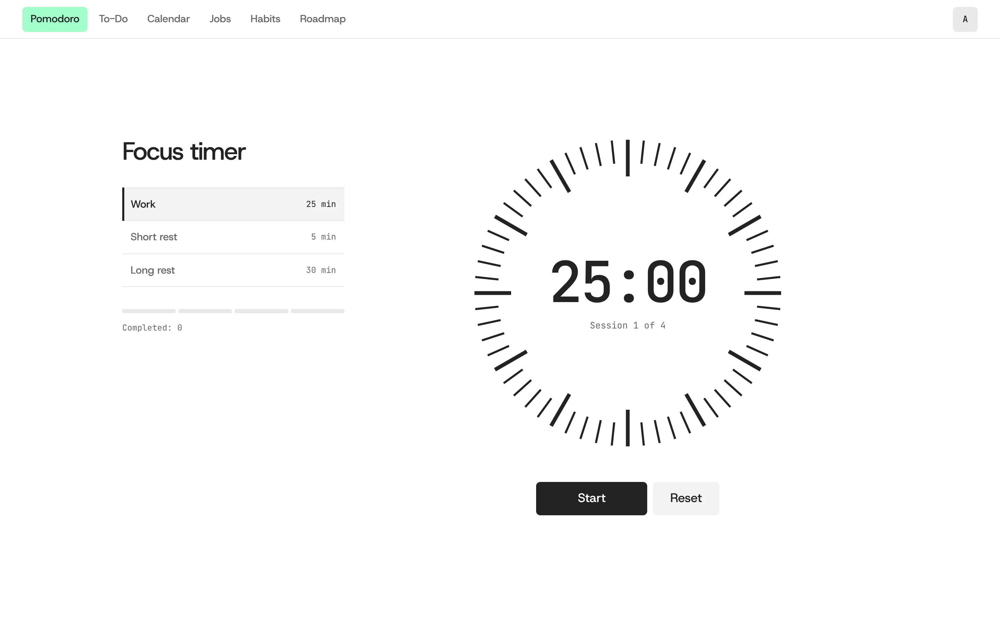
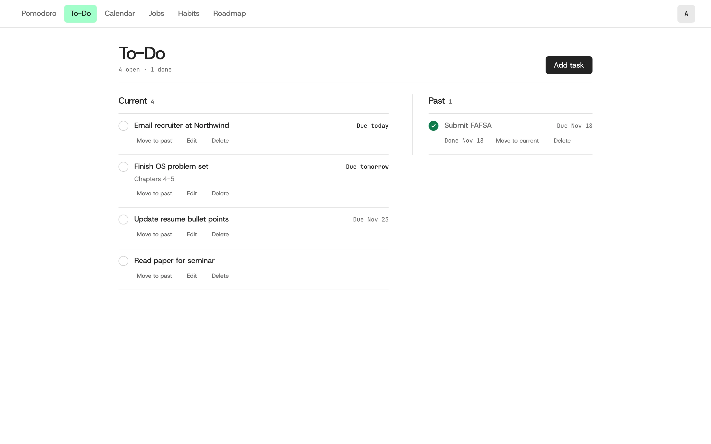
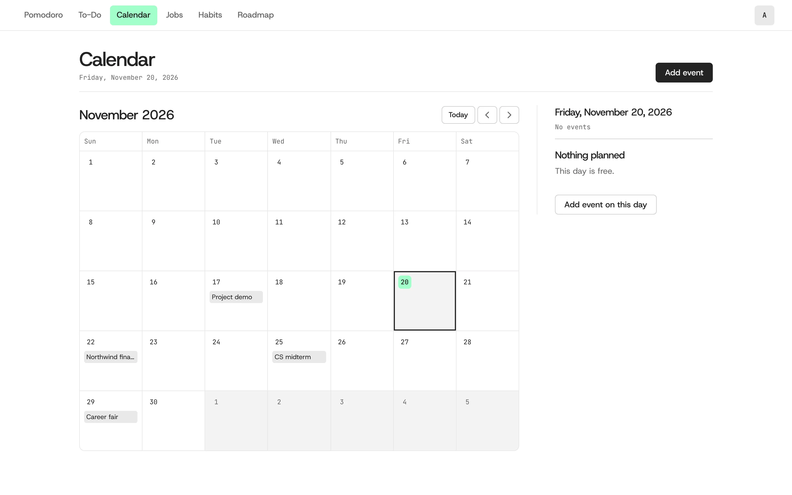
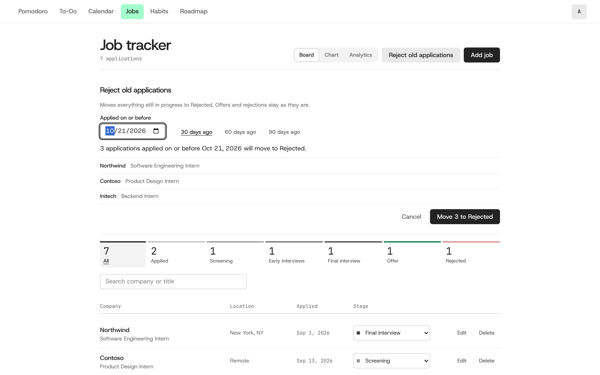
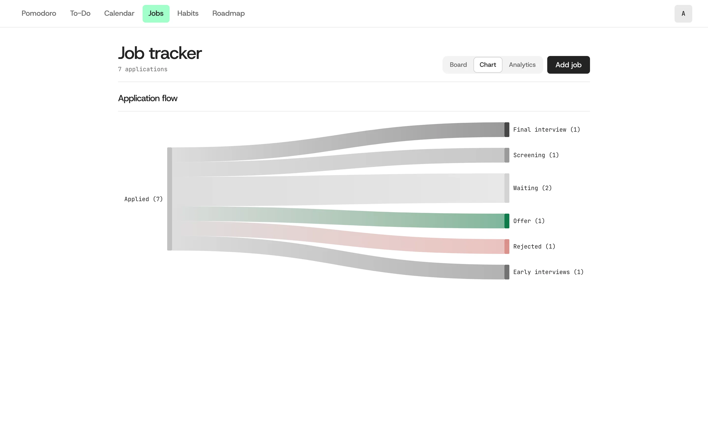
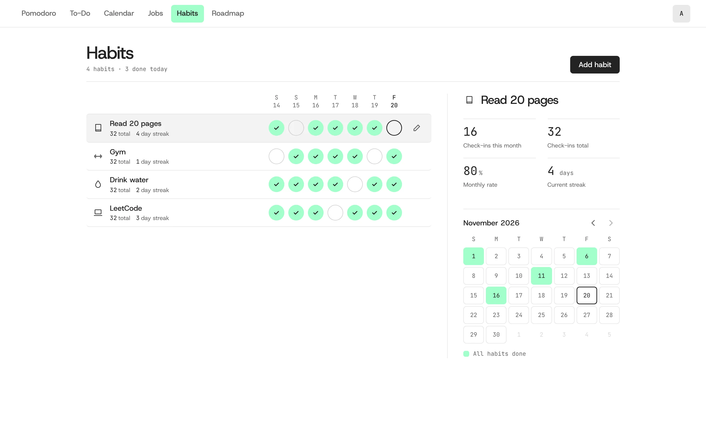
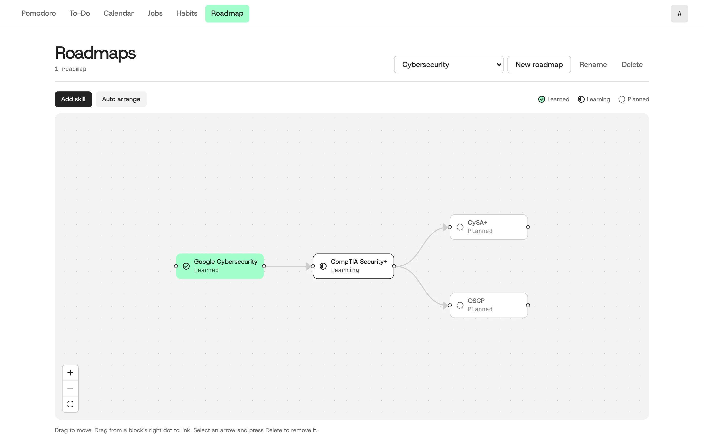
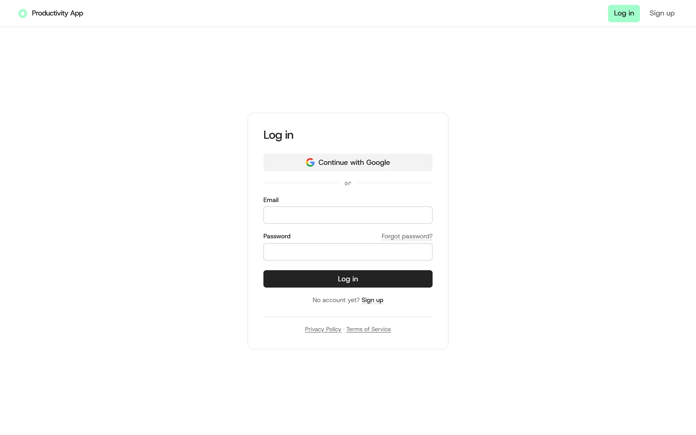

# Productivity-App
Site: https://productivity-app-client-gamma.vercel.app/
Creating a productivity app for myself to help with learning, see README for more info. 

Productivity App will include four main things that will be helpful for learning
1. Pomodoro Timer, 25 minute work, 5 minute rest, every 3 hours, 30 minute rest
2. Internship/Application tracker, will include 6 categories: rejection <- applied -> screening -> interviews -> final round interviews -> offer
3. Daily habits tracker, include a checkmark for each day
4. Roadmap for new skills: for ex: learning cybersecurity: once you learn the basics, you can draw out an arrow from that basic certification into a new skill
your looking to learning. It would look like: Google Cyber Sec -> CompTIA -> more advanced Cyber Sec certs

Overview: 

